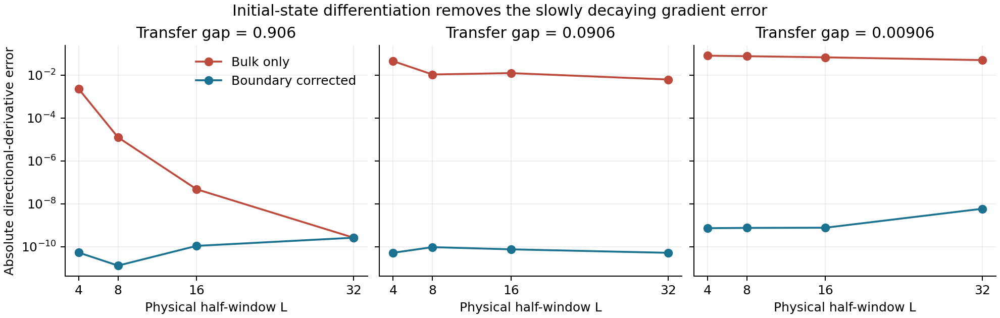

# Validation and measured performance

The original-code comparisons below use Julia 1.12.7, ComplexF64, one Julia
thread and one OpenBLAS thread, on one workstation. `benchmark/environment.txt`
records the RcmpsCore 0.2 dependency versions; the versions of the 0.1-side
packages in the `benchmark` environment were not recorded.
Benchmark scripts fix their RNG seeds. Timing claims below use warmed evaluations
and the minimum of three samples. Allocation counts are **cumulative allocated
bytes**, not peak resident memory. CPU model and BLAS details are recorded in
`benchmark/environment.txt`.

## Boundary correction

`benchmark/boundary.jl` compares the analytic directional derivative against a
central finite difference of the finite-window vertex expectation, recomputing
rho after each canonical retraction. ODE tolerances are 1e-12; the finite-difference
step is 1e-5. A fixed random state is scaled as R→sqrt(s)R and K→sK to change all
transfer eigenvalues by s. A separate SciPy implementation,
`benchmark/boundary_reference.py`, checks the same derivation with independent integration and dense linear algebra.

Representative Julia results at physical half-window L=16:

| Transfer gap | Bulk-only error | Corrected error |
|---:|---:|---:|
| 0.906 | 4.73e-8 | 1.09e-10 |
| 0.0906 | 1.23e-2 | 7.48e-11 |
| 0.00906 | 6.69e-2 | 7.62e-10 |

The Poisson solve alone costs about 0.2–2.4% of the full vertex gradient on these
D=3 examples. This percentage is not extrapolated to large D. Corrected errors
are limited by finite differences and numerical solves; their small rise at the
longest window is not evidence of another missing physical tail. The correction
is exact for the chosen finite window. Full raw data are in `benchmark/boundary.csv`
and `benchmark/boundary_reference.csv`.

## Observable performance against the original code

`benchmark/performance.jl` reads the original implementation through a small
compatibility adapter. It retains Octavian, original array layout, original
quadrature and algorithms, adapting only the Vern7 import and saved-solution
indexing to current SciML. No original files are edited.

The benchmark computes the **fourth field moment and its gradient**, not the
complete phi4 energy. Both implementations use the same state, physical window
20, ODE tolerances (atol=1e-11, rtol=1e-10), and metric regularizer. The original
uses its default 1000 exp-sinh steps; RcmpsCore 0.2 uses its default 128 Gauss nodes
per half and includes the boundary correction. This compares complete configured
algorithms; it is not a matrix-multiplication microbenchmark.

| D | 0.1 seconds | 0.2 seconds | Speedup | Allocated bytes reduction |
|---:|---:|---:|---:|---:|
| 4 | 0.263 | 0.0522 | 5.04× | 18.2× |
| 8 | 0.364 | 0.104 | 3.49× | 14.3× |
| 16 | 1.099 | 0.376 | 2.92× | 12.7× |
| 32 | 3.850 | 1.799 | 2.14× | 12.5× |

The moment values differ by 1.3e-8–6.3e-8 in this sweep. The old code is not an
accuracy oracle: its singular-source handling and quadrature differ. New-code
accuracy is checked independently using coherent states, finite differences,
and refinements of window, quadrature and ODE settings. Old and new gradients
are expected to differ because only RcmpsCore 0.2 includes the boundary term.

## Stationary-state performance

The baseline here is the original direct Krylov eigensolve on L (its cheapest
path), with Krylov dimension at most 80 and 200 restarts. Its expensive squared-L
and power-method fallbacks are not invoked. RcmpsCore 0.2 uses the CPTP solver,
including checks and the small-D uniqueness test.

| D | 0.1 seconds | 0.2 seconds | Speedup |
|---:|---:|---:|---:|
| 4 | 0.000189 | 0.000337 | 0.56× |
| 8 | 0.00536 | 0.00270 | 1.98× |
| 16 | 0.07395 | 0.00372 | 19.9× |
| 32 | 0.1537 | 0.01671 | 9.20× |

The new method is slower at D=4. Both methods' physical residuals are below
1.2e-13 in this sweep, and their densities agree to 1.3e-13 or better. These are
representative dense random states, not a universal convergence guarantee.
Raw data, including allocation counts, are in `benchmark/performance.csv`.

## Regression coverage

The updated suite passes **211 checks with six compute threads**, including
threaded evaluation, failed-trial rejection, and the infinite-line kinetic
resolvent and matrix-free Krylov backends. Its direct test-run log,
`benchmark/threading/tests_krylov_t6.log`, is not in any git repository: it is
kept in the local archive tarball of the companion research repository
rcmps-phi4-z2 and listed in that repository's `ARCHIVE_MANIFEST.tsv`. The
single-thread fallback passes **209 checks** (log
`benchmark/threading/tests_krylov_t1.log`, archived there too); two worker-join
checks only apply with multiple threads. Earlier 105-check results remain in
`benchmark/test-output.txt`; the original 100-check suite also passed via `Pkg.test`. An actual historical JLD file was also migrated
and reloaded; its recomputed stationary residual was 7.1e-16.

The executable test suite checks canonical gauge and tangent identities,
column-major transfer vectorization, Lindblad adjoint duality, trace preservation,
CPTP-versus-dense steady states, positivity, dark states, defective no-jump
matrices, Poisson residuals and dense agreement. Observable checks include exact
coherent-state values and independent finite differences for real and imaginary
vertices, monomials, both kinetic terms, phi4, sine-Gordon, sinh-Gordon and the
modified-mass energy. It also checks zero allocations in the warmed ODE RHS,
solver failure propagation, file round trips, state selection, optimizer descent,
quadrature/window refinement and concurrent evaluation of a shared state.

## Saved-state regression

`benchmark/saved_states.jl` loads historical JLD files, recomputes rho, and checks
the full energy derivative against a central difference (step 1e-4). These runs
use 192 nodes per half and ODE tolerances 1e-12.

| Saved state | Transfer gap | Recomputed energy | Absolute difference from saved energy |
|---|---:|---:|---:|
| phi4, g=1, D=8 | 1.433 | -0.038487940915 | 1.5e-11 |
| phi4, g=2, D=16 | 0.530 | -0.156560876210 | 6.8e-10 |
| phi4, g=2, D=28 | 0.475 | -0.157174217420 | 1.0e-9 |

Directional derivatives agree within 3.0e-9 in these checks. The boundary
correction is negligible for these particular saved states at window 20; they
are not evidence of a small-gap optimization improvement. The deliberately
scaled random states in the boundary benchmark isolate that regime.
`benchmark/saved_states.csv` records the complete results. Its `seconds` column
includes the first compilation when applicable and is not used for speed claims.

## Small-gap optimization diagnostic

`benchmark/optimization.jl` runs 20 iterations of released OptimKit LBFGS with
bounded Armijo backtracking, starting from the same scaled D=3 state (seed 718,
R scaled by 0.1 and K by 0.01, phi4 coupling 2, window 12). Both variants use the
new observable engine; only the stationary-state boundary derivative is toggled.
The reported final gradient norm always uses the **corrected** gradient.

| Gradient supplied to optimizer | Initial energy | Final energy | True gradient norm | Outcome |
|---|---:|---:|---:|---|
| Bulk only | 0.0146803 | 2.06e-8 | 4.69e-4 | Stopped on nonunique/unresolved stationary state |
| Boundary corrected | 0.0146803 | -0.0266615 | 0.276 | Reached 20-iteration limit |

The old-gradient trajectory approaches a redundant near-vacuum representation
where the explicit small-system uniqueness check refuses to continue. The
corrected trajectory reaches a lower, negative energy. Neither run demonstrates
convergence to the ground state. Their wall times (0.33 s versus 34.2 s) reflect
different trajectories and work, and **are not a speed comparison**. This is one
controlled diagnostic, not a claim that all initializations optimize faster.
Raw results are in `benchmark/optimization.csv`.

The 20-iteration D=8 example also completes and writes a checkpoint, lowering
energy from 0.1987503 to -0.1007806. It exercises a stalled Krylov boundary solve
and the new checked dense fallback. The example stops at its iteration limit
with `converged=false`; its output is in `benchmark/example-output.txt`.

## End-to-end g=2 dimension sweep

A subsequent matched-start comparison at D=2,4,8,16 benchmarks 30 LBFGS
iterations of the actual old and new full-energy pipelines. See the
[full optimization report](../benchmark/full_optimization.md) for energies,
timings, corrected gradient norms, transfer gaps, and the retained D=4 failure.
The new code is faster on the completed pairs; no run reaches the requested
gradient tolerance, so these are fixed-budget results rather than converged
optimization timings.

The follow-up converged comparison (`benchmark/converged/README.md` in the
companion research repository rcmps-phi4-z2) raises
the iteration limit to 1000 per precision stage, uses a shared safeguarded line
search, and checks every final state with the corrected gradient and a larger
integration window. It includes additional high-precision polishing where the
old objective's numerical noise stalls strict descent. This report supersedes
the 30-iteration sweep for comparing converged energies.

## Threading and structured kinetic evaluation

The threading report (`benchmark/threading/README.md` in the companion research
repository rcmps-phi4-z2) compares one through six
compute threads and records full optimization results using unchanged ODE
window/accuracy settings. Threaded ODE results are checked for exact equality
with serial evaluation. The optional kinetic resolvent backend instead computes
infinite-line kinetic terms and checks energy and complete gradient convergence
under angular quadrature refinement. Its derivation, independent checks, and
matrix-free research extension are in the structured-observables report,
`research/structured_observables/README.md` in the companion research repository
rcmps-phi4-z2.
